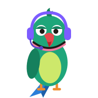

# English Adda — Game Research 2: from worksheets to games

*12 Nov 2026. Written after the product owner played step 3 and said the games are boring. This doc adds to the first Research doc; it does not replace it. Nothing here is built yet.*

**How to read the trust tags.** Three research passes were run (academic literature, market teardown, audience). Each claim is tagged:

- **[V]** checked against a source in this round (abstract, article or product page).
- **[M]** from memory of the paper or product, not re-checked. Check before quoting a number to anyone.
- **[J]** our judgement, no data.
- **[no data]** we looked and found nothing usable.

---

## 1. The short version

1. **Why the current games feel boring.** Every game has the same shape: *item 3 of 10 → answer → read a paragraph → press Next*. That is the shape of a worksheet. Lumosity, Elevate and the Brain Gym games students like (Color Clash, Symbol Sprint, Bug Tracker) have a different shape: one action, repeated 40–80 times in two minutes, with something always moving, and a score you try to beat.
2. **The research agrees with the owner.** The best-supported formats (recall, judging a word in a sentence, building sentences, timed easy reading) are also the ones that make good fast games. The weakest-supported formats (spotting errors on its own, C-tests as practice, typing a full sentence after audio) are three of the things we built.
3. **What we should build.** Ten original games on one shared "run" engine, built in three waves. Each has one action, a physical picture that explains the rule, a calm mode first and a fast mode after, and an end card with your best score and a curve. Details in §6.
4. **Mithu.** He comes back as the host. He must look nothing like Duolingo's owl, and he must be a sharp commentator, not a bird that repeats. A first sketch and a character brief are in §8.
5. **Decisions needed from the owner** are listed in §11. Building starts after those.

---

## 2. What is wrong with the games we have

I read the game code (`public/english/english.js`) and compared it with the Brain Gym games.

| | Adda games now | Brain Gym games students like | Lumosity / Elevate |
|---|---|---|---|
| Decisions in 2 minutes | 8–20 | 40–100 | 40–80 |
| Screen between items | Explanation text + Next button (Real or Fake waits 3–5 s) | None | None |
| Counter on screen | "Sentence 3 of 8" | Clock and score | Clock and score |
| Motion | Card shakes or turns green | Things move all the time | Things move all the time |
| What you touch | Buttons under the question | The thing itself | The sentence or word itself |
| End of round | "You got 7 of 10" | Score vs your best | Score, best, last five, level bar |
| Reason to replay | None | Beat your score | Beat your score |

Other problems:

- **All five games look the same.** White card, purple button, text. Each Lumosity or Elevate game has its own small world.
- **The teaching interrupts the play.** We stop after every item to explain. Good for learning one item, bad for flow. The fix (from Brilliant and from the feedback research) is a 300 ms correction on the item itself, then a short review of only the misses at the end.
- **No fast, easy play.** Everything is "learn something new". Nothing lets a student feel quick and good with what they already know. Language teaching calls this the fluency strand, and it is a quarter of a balanced course (Nation 2007 [M]).

---

## 3. What the academic literature says

Full notes are in the session log; the points that change our design are below. The first Research doc (§4) already covers spaced recall, gamification effect sizes, leaderboard risks and feedback basics.

### 3.1 Game-based language learning
- Games help language learning by about half a standard deviation (Dixon, Dixon & Jordan 2022, *Language Learning & Technology* [V]). Games made for fun did a little better than games made for teaching.
- How the game is designed matters about as much as having a game at all: games vs no game 0.33; better-designed version vs plain version of the same game 0.34 (Clark, Tanner-Smith & Killingsworth 2016 [V]).
- **Warning.** In deHaan, Reed & Kuwada 2010 [V], students who *played* a music game remembered fewer words than students who only *watched*. The game actions had nothing to do with the language, so they stole attention.
- **So:** the tap or drag must itself be the language work. No shooting, jumping or steering laid on top.

### 3.2 Vocabulary
- What matters most is making the learner **judge or use the word in a context**. Looking a word up added nothing (Yanagisawa & Webb 2021, 42 studies [V]).
- Seeing a word many times is a weak lever on its own (r = .34; Uchihara, Webb & Yanagisawa 2019 [V]). Activity type matters hugely: 18–77% of words learned depending on the activity (Webb, Yanagisawa & Uchihara 2020 [V]).
- Recall beats recognition. Order of difficulty: recognise meaning → recognise form → recall meaning → recall form (Laufer & Goldstein 2004 [M]).
- About 10 meetings with a word are needed (Webb 2007 [M]). Total spacing matters more than the exact schedule (Nakata 2015 [V]).
- **So:** a word should be met 8–12 times across *different* games and days, moving from "see it" to "judge it in a sentence" to "type it from a clue".

### 3.3 Grammar
- Telling the rule plainly works better than hoping learners pick it up (Spada & Tomita 2010 [V]). Feedback on errors has a medium, lasting effect (Li 2010 [V]).
- Highlighting text (bold, colour) hardly teaches anything (Lee & Huang 2008 [M]).
- For grammar, practising a pattern many times in one sitting is fine, unlike vocabulary (Suzuki & DeKeyser 2017 [V]).
- Sentence combining improved writing (0.50); teaching grammar on its own did not (−0.32) (Graham & Perin 2007 [V]; school pupils writing in their first language, so treat as a pointer).
- Fast right/wrong judgement draws on the kind of knowledge used in live speech and timed tests (Ellis 2005 [M]). There is little direct proof that practising it improves writing, so we pair it with building games.
- **So:** build and combine sentences more, hunt errors less. After a miss: one-line rule, then two or three fresh items on the same pattern straight away. Time a pattern only after the student gets it right untimed.

### 3.4 Listening and reading speed
- Timed repeated reading raised speed by about 45 words a minute and also helped on new texts (Chang & Millett 2013 [V], only 13 students). Speed-reading gains carried over to other reading (Tran & Nation 2014 [V citation]).
- Partial dictation (sentence shown with a few gaps) beats no dictation in small studies [V]. No large review exists.
- C-tests are a good *measure*. We found no evidence that doing them *teaches* [M]. Keep them in the level check only.
- **So:** add a reading-speed game with a personal words-per-minute graph, and change Catch It from "type the whole sentence" to "fill the gaps you could not hear".

### 3.5 Short writing and AI feedback
- AI feedback improved revision only a little (d = 0.19) but raised motivation (0.36) (Meyer et al. 2024 [V]).
- Students with plain ChatGPT did better in practice and **17% worse** once it was taken away; a hint-only tutor removed most of the harm (Bastani et al. 2025, *PNAS* [V]; maths, one school).
- A third of feedback studies found feedback made performance worse, mostly when it was about the person and not the task (Kluger & DeNisi 1996 [M]).
- **So:** the judge gives hints, never the rewritten answer. Feedback talks about the sentence, never the student.

### 3.6 Motivation and difficulty
- In 20,000+ sessions of a learning game, even medium difficulty lowered play time. Novelty, choice and suspense did the job people expect difficulty to do (Lomas et al. 2013, 2017 [V]).
- The "85% right" rule comes from a maths model of machine learners, not from language students (Wilson et al. 2019 [V]). Use it as a first guess.
- Points, levels and leaderboards increase how much people do, not how much they want to (Mekler et al. 2017 [V]).
- Gamification's effect dropped after about week 4, then partly came back (Rodrigues et al. 2022, 14 weeks [V]).
- Streak effects: still only company data.
- **So:** aim for 80–90% right on the first try, lean easy for weak students, and get excitement from near-misses, reveals and new mechanics. Plan something new around week 4.

### 3.7 Lessons from brain training
- Lumosity paid $2 million to the US FTC in 2016 for claims it could not support [V]. Reviews find people get better at the games they practise and tasks very close to them, with little effect on daily life (Simons et al. 2016 [V]; Sala & Gobet 2019 [V]).
- Independent evidence for Duolingo is thin (Loewen et al. 2019, nine learners [V]).
- **So:** our games must be the placement task in game form (close transfer). We claim only what our own check measures, and the Boss Round uses a different format from the daily games so we measure English, not game skill.

### 3.8 Indian learners
- Fluent English goes with about 34% higher hourly wages for men, after controls (Azam, Chin & Prakash 2013 [V]).
- Hindi, Telugu and Tamil have no articles, put the verb last and have no "do" in questions. Expected errors: articles, prepositions, question word order, "-ing" with verbs like *know* and *have* [M]. Small studies of Tamil-medium engineering students agree, adding tense choice and missing "-s" [V].
- We found no solid study of Telugu-speaking undergraduates, and none comparing English-medium with regional-medium engineering students. Our own game logs can fill this.
- **So:** weight grammar content to articles, prepositions, tense and question order. Log misses by pattern.

---

## 4. What the market does

The first doc has the product table. This round looked at mechanics and feel. Elevate's and Lumosity's help pages blocked us, so some details are from memory. **Someone on the team should play Elevate, Lumosity's word games and Knudge.me for 20 minutes each before we lock designs.**

### 4.1 What each product teaches us

- **Lumosity** [V for game list]. Its word games: recall words from a starting stem; pick all synonyms fast; drag words into order by strength; find the words that do not fit a story. A daily workout is a short set of 1–3 minute games shown as cards you tick off [M]. Scores feed a personal index. It compares you with yourself.
- **Elevate** (closest to what we want) [V for most]. Tap the word that can be cut from a wordy sentence. Tap Valid or Error on a sentence. Swipe a word to "positive" or "negative". Read text at rising speed. Each game is 60–120 s with its own art. **Complaints to avoid** [V]: every game is timed, so the clock matters more than learning; no time to think after a wrong answer; content repeats after months.
- **Brilliant** [V for basics]. No videos. One idea per screen. You move something, guess, then get the reason. Wrong answers are explained, not punished. For language this means: drag a comma and see the meaning change; slide a message from "chat" to "formal" and watch the words change.
- **Duolingo.** Fast modes (pair matching against a shrinking clock [V]) are its most game-like part. Mascot with attitude is the brand [V]. Users hate blocked practice, guilt reminders and AI-made content [V].
- **Word-game hits** [M]. Daily shared puzzle with a share grid; a rank ladder that turns an open task into a goal; letter-swipe as a pleasure in itself; typing games where restart takes one key press.
- **Classroom games** (Kahoot, Blooket, Gimkit) [M]. The quiz is fuel; the fun is the game on top. Useful later for class events.
- **India.** Knudge.me has English mini-games with generic arcade skins [V]. Hello English has challenges but is reported buggy [V]. Placement sites (IndiaBix, PrepInsta) are plain question lists [M]. Speaking apps are not game-like.

### 4.2 Eleven rules that separate a game from a quiz

1. **One action per game.** Tap, swipe, drag or type. Nothing else.
2. **The text is the playfield.** Touch the sentence itself, not option buttons under it.
3. **Decisions take 1–3 seconds.** Two minutes = 40–80 decisions.
4. **Something always moves.** No Next button. No "question 3 of 10".
5. **A clock or moving object sets the pace, and hits in a row build a multiplier.** A calm mode exists too (see §5 rule 5).
6. **One physical picture per game** that explains the rule without words: a train, a pair of scissors, a dial.
7. **A run restarts in one tap.**
8. **Feedback happens inside the motion** (sound, colour, a quick fix shown on the item). Misses are reviewed on the end card.
9. **The result is a curve:** score, personal best, last five runs. Never "7 out of 10".
10. **The session is a playlist** of 3–5 different games picked for you.
11. **Difficulty changes quietly during the run.** The student notices only the level-up.

### 4.3 Gaps nobody has filled

- Grammar with motion (everything except Elevate is multiple choice).
- Listening as a fast game (everyone does "play, type, submit").
- Chat-to-formal tone as a toy.
- Indian English errors as the content.
- Campus settings instead of space ships and pandas.
- Short writing judged in seconds.

---

## 5. Who we are building for

### 5.1 Findings

- **Phone first.** Under 10% of Indian homes have a computer; 85% have a smartphone (CMS-T 2025 [V]). B.Tech students often have laptops, but plan for a phone in one hand.
- **They read English and listen in their own language.** English is preferred for reading (42%); local languages for video (56%) and audio (57%) (Google–Kantar 2025, 4,000+ Gen Z [V]). This explains weak listening.
- **Data is cheap** (about 31 GB a month per user [V]), but hostel networks drop [anecdotes only].
- **Women are 45% of Indian gamers** (Lumikai 2025 [V]). Women lean to puzzle and casual games, men to shooters and competition (older data [V]).
- **Ranks and seasons are familiar** from BGMI [J]. **Chess.com has 1M+ daily users in India** [V, company figure], which shows a "smart" game with a rating can be cool.
- **Real-money gaming was banned in August 2025** [V]. Never copy betting or cash.
- **Accent and English shame are real.** 62% of Indian test takers think their accent hurts their score (Pearson [V]). A study of first-year engineers links English stigma to self-image [V].
- **Placement English is a speed task.** TCS, Infosys and Wipro verbal sections give under a minute per question (prep sites, which disagree on details [V]). Accenture and Cognizant use listening, sentence building and story retelling.
- **Tone.** Short, witty, about a shared moment works (Zomato, Swiggy [V]). Over-familiar or guilt-based messages backfire (Zepto backlash [V]; Duolingo reminder complaints [V]). Institutions using Gen Z slang get called cringe [V].
- **Streaks.** People can start caring about the streak more than the activity, and many quit when it breaks [V, secondary].
- **[no data]:** peak hours for college students, earphone ownership, comfort typing English on a phone, attitudes to ranking. Our own logs and the launch survey must answer these.

### 5.2 Rules for this audience

1. Design for a 360 px wide phone, one hand. Laptop is the second layout.
2. Load a whole round (text and audio) before it starts. Save answers on the phone and send later if the network drops.
3. Sound is never required. Listening games ask "Earphones in?" first and offer another game if not.
4. Tap, swipe and drag first. Typing only in short bursts, and forgive thumb slips where spelling is not the skill.
5. **Calm first, fast after.** Each game opens in an untimed "Chill" mode. The timed "Rush" mode opens once the student is right about 80% of the time. The student can always choose Chill. This handles both the placement clock and the anxiety findings.
6. Half the games are puzzles, half are speed games.
7. No guilt. A missed day gets a normal hello.
8. Plain English. At most one internet word per screen. No Hinglish in instructions.
9. Jokes are about the situation (mess food, Tatkal, the HOD), never about the student's English, accent, town or school.
10. Use words they already own (game, creator and tech words) as a bridge to formal words.
11. Settings come from all of India, not only the north: trains, cricket, hostel, fests, food delivery, group chats.
12. Placement stays in the background. Every screen leads with today's win.

---

## 6. The new games

All ten are original designs. They use mechanics that are common across many products, not any one product's name, art, content or levels.

Every game shares one **run engine**: a start card with Mithu and a one-line rule, a 60–120 s run, a clock and score at the top, a combo meter, pause, an end card (score, best, last five runs as a small curve, "Play again" as the biggest button), then **Miss Replay**: only the items you missed, slowed down, with the one-line reason and a fresh item on the same pattern.

### Wave 1: prove the feel (4 games)

| Game | Action | What happens | Skill → placement task | Why (evidence) | Content |
|---|---|---|---|---|---|
| **Flick** | Swipe | A sentence card slides in. Swipe right if it sounds right, left if something is off. 1–3 s each. Hits in a row light a streak flame and raise the multiplier. A wrong swipe flashes the faulty words for a moment and moves on. | Grammar → error identification (TCS, Infosys, AMCAT) | Fast judgement taps the knowledge used under a clock; one-line rule and fresh retry in Miss Replay (§3.3) | Reuses all 192 Spot & Fix items; each gives a wrong and a right card |
| **Express** | Tap | A train waits at the platform. Sentence pieces are coaches in the yard. Tap them in order to couple them. A wrong coach bounces back at once. When the last coach clicks on, the train leaves and the next one rolls in. In Rush, the signal counts down. | Grammar → sentence building (Versant, Cognizant jumbled sentences) | Building beats error hunting (§3.3); no Check button, feedback inside the motion (§4.2) | Reuses all 192 Jumble items |
| **Pair Up** | Tap | A board of 8 tiles: words on one side, partners on the other (meaning, or the word it goes with: *make + a decision*, *take + a break*). Tap a pair and both tiles are replaced at once, so the board never empties. Each stage is a little faster. | Vocabulary → synonyms, word choice | Pairs like *make/do* force a judgement in context (§3.2); refilling board gives constant motion | Reuses 320 words; needs about 150 new word-partner pairs |
| **Catch It** (rebuilt) | Tap, later type | "Earphones in?" A sentence plays once. It appears with 2–4 gaps on the words that are hard to hear (*a/the*, *-ed*, *-s*, small joining words). Tap the right word tiles into the gaps before the sound wave fades. Higher levels: type the gap words. | Listening → dictation, sentence repeat (Versant, Accenture, Cognizant) | Partial dictation, less typing, same ear training (§3.4); keeps the owner's one-play rule | New: about 150 sentences with gap marks; audio through the existing voice script |

Wave 1 covers one puzzle-leaning game (Pair Up), two speed games (Flick, Express) and listening. **Word Groups stays** as the one shared daily puzzle. It already has the right shape (a puzzle with an "aha" and a share grid) and the owner has tuned it.

### Wave 2: widen (4 games)

| Game | Action | What happens | Skill → placement task | Why | Content |
|---|---|---|---|---|---|
| **Trim** | Tap | A wordy sentence with a pair of scissors. Tap the words that add nothing (*return **back***, *discuss **about***, *repeat **again***, *free **gift***). They snip away and the sentence closes up. | Writing → concise, formal writing (email tasks) | Editing real text; uses the Indian English "formal only" list from the first doc | New: about 150 sentences |
| **Fast Read** | Read, tap | A short, easy story (100–120 words, almost all known words) appears a line at a time. Read it at your own speed, then answer one quick detail question so nobody can skip. Your words-per-minute goes on a graph. The same story comes back on two later days so you beat your own time. | Reading → comprehension under time | Timed repeated reading (§3.4); the missing "fast and easy" strand (§2) | New: about 60 stories, level-tagged with the existing word-frequency check |
| **Vault Run** (replaces Word Vault) | Type | Words you have met drift down the screen as a meaning plus the first letters (*"say sorry" → apo _ _ _ _ _ _*). Type the rest before it lands. Only your own saved and missed words appear, on a spaced schedule. | Vocabulary → recall and spelling | Recall of form is the strongest step (§3.2); 8–12 spaced meetings | No new content; uses the vault |
| **Tone Dial** | Drag | A phone shows a message. A dial runs from "Group chat" to "Mail to HR". As you turn it, the message rewrites itself through four versions. Stop the dial where it fits the person shown (friend, senior, HOD, recruiter). Later levels: one version has a slip; spot which. | Writing → register (email tasks, interviews) | Brilliant-style "move it and see" (§4.1); the register gap is their real weakness (§5.1) | New: about 80 message sets of four |

### Wave 3: keep it fresh around week 4 (2 games + events)

| Game | Action | What happens | Skill |
|---|---|---|---|
| **Scale** | Drag | Four or five words on a thermometer. Drag them into order from weak to strong (*okay → good → great → brilliant*). | Vocabulary shades of meaning |
| **Type Dash** | Type | Type a short sentence at your level against your own ghost from last time. Shows speed and accuracy. Laptop-friendly; on phones it is optional. | Writing fluency (Versant typing section) |

Also in wave 3: Boss Round in a different format from the daily games (§3.7), and a class event mode if the pilot asks for it.

### What happens to the step 3 games

| Step 3 game | Decision | Reason |
|---|---|---|
| Word Groups | Keep as the daily shared puzzle | Right shape already |
| Real or Fake | Keep in the level check only; its words feed Pair Up and Vault Run | As a daily game it is recognise-only |
| Jumble | Becomes Express | Same content, new feel |
| Spot & Fix | Becomes Flick | Weakest evidence as a stand-alone; content reused |
| Word Vault | Becomes Vault Run | Same spacing engine, now a game |
| Catch It | Rebuilt as partial dictation | Less typing, better evidence |
| Story Rewind, Vanish, Fix My Email (not built) | Hold | Need the AI judge; revisit after wave 2 with hint-only feedback |

Nothing is thrown away: 320 words, 192 jumbles, 192 spot-and-fix items and 30 group puzzles all carry over. The server side (round picking, first-attempt scoring, level-up rule) stays.

---

## 7. Session, scores and progress

- **Today's Adda** becomes a playlist of 4 cards: the daily Word Groups puzzle plus 3 games picked from the student's weakest and least-played skills, each a different action. Tick them off. After that, any game is free play until the 25-minute close.
- **Score per game:** points for each hit × multiplier. The end card shows this run, your best, and your last five runs as a small line. No "7 of 10".
- **Skill meters (private).** The five skills keep their 1–8 levels. Each game's results feed its skill. A level-up is the big moment and says what you can now do ("You now handle *since* and *for*"), because rewards that tell you about your skill work better than points alone (§3.6).
- **Seasons.** Four weeks each. The class leaderboard counts effort only (goal days and games finished) and resets each season. Each new season brings one new game or mode, which is also our answer to the week-4 drop.
- **Streak** stays as designed: goal days, one miss forgiven per 7 days, no guilt copy.
- **Adda points** stay separate from Brain Gym and Drive points.

---

## 8. Mithu

The owner has asked for Mithu back as host. He replaces Yapper in English Adda. Turbo stays in Drive School.

**Risks we must design around** [J, no data exists on this]:

1. **Looking like Duolingo's owl.** This is why he was dropped before. Mithu must be a slim Indian rose-ringed parakeet: long tail, red hooked beak, dark neck ring. Not round, not an owl, not lime green.
2. **"Rattu tota".** A parrot stands for learning by rote. Mithu must never repeat. He is the campus commentator who has overheard every hostel conversation. His own line on it: *"I don't repeat. I remix."*
3. **Looking childish.** No baby talk, no "Good job, champ!". Dry, quick, kind.
4. **The name is north Indian.** Neutral at worst for Telugu, Tamil and Kannada students [J]. Earlier the owner disliked Indian "-u" names for new mascots; the owner has now chosen this one, so we go with it.

**First sketch** (one pose, for a yes/no on direction, not final art):

Deep green body, yellow-green front, blue tail, red beak, rose-and-black neck ring, half-closed eyes, purple commentator headphones with a small mic (purple ties him to the Adda colours).

**Voice in text.** One short line at a time. Examples:

- Start of Flick: "Sounds right? Swipe right. Sounds off? You know what to do."
- Combo of 10: "Ten in a row. I felt that."
- A miss: "*Discuss about*? Drop the *about*. Next."
- Coming back after a gap: "You're back. The mess food hasn't improved. Shall we?"
- End card, new best: "New best. I'm telling everyone. (I'm not. Levels are private.)"

**Spoken voice.** Options: keep the current Kokoro Heart voice, or switch to the free second (male) Kokoro voice that was already allowed for dialogues. Owner's choice (§11).

**Work when approved:** four poses (idle, correct, thinking, oops), a web search for look-alikes as we did before, swap the art and the YAPPER_LINES block, re-record with `python scripts/english-voice.py`, update CLAUDE.md.

---

## 9. What we should not claim

- Not "makes you fluent" or "improves communication". We can say "practises the same task types as placement tests".
- Numbers only from our own check: level check at the start and again at about week 8, compared by how much each student played.
- Vendor employability numbers disagree by 14 points between reports (56% vs 42.6% [V]). Do not quote either as fact.

---

## 10. Build plan

1. **Run engine + end card + Miss Replay** (shared by every game), and Mithu art if approved.
2. **Flick and Express** first. They reuse existing content, so the owner can feel the difference within one build step.
3. Owner plays. If the feel is right, **Pair Up and Catch It**.
4. Playlist home screen, seasons, score curves.
5. Wave 2, then wave 3 at about week 4 of the pilot.

Each content batch still goes through `node scripts/english-content-check.mjs` and a separate reviewer agent.

---

## 11. Decisions needed from the owner

1. **The lineup in §6.** Any game to drop, add or rename?
2. **Mithu's look** (the sketch) and **his voice** (current Heart voice, or the male voice).
3. **Chill first, Rush after** (§5.2 rule 5): agree, or should games open timed?
4. **Step 3 games:** fine to turn Jumble, Spot & Fix and Word Vault into Express, Flick and Vault Run, and keep Real or Fake only in the level check?

---

## 12. Sources checked in this round

**Literature:** Dixon, Dixon & Jordan 2022 (LL&T 26(1)); Tsai & Tsai 2018 (Computers & Education 125); Clark, Tanner-Smith & Killingsworth 2016 (RER 86(1)); deHaan, Reed & Kuwada 2010 (LL&T 14(2)); Yanagisawa & Webb 2021 (Language Learning 71(2)); Uchihara, Webb & Yanagisawa 2019 (Language Learning 69(3)); Webb, Yanagisawa & Uchihara 2020 (MLJ 104(4)); Nakata 2015 (SSLA 37(4)); Spada & Tomita 2010 and Li 2010 (Language Learning 60(2)); Suzuki & DeKeyser 2017 (LTR); Graham & Perin 2007 (JEP 99); Chang & Millett 2013 (RFL 25(2)); Tran & Nation 2014 (e-FLT 11(1)); Meyer et al. 2024 (Computers and Education: AI 6); Bastani et al. 2025 (PNAS 122(26)); Wilson et al. 2019 (Nature Communications 10:4646); Lomas et al. 2013, 2017 (CHI); Mekler et al. 2017 (CHB 71); Rodrigues et al. 2022 (IJETHE 19:13); FTC v. Lumos Labs 2016; Simons et al. 2016 (PSPI 17(3)); Sala & Gobet 2019 (TiCS 23(1)); Loewen et al. 2019 (ReCALL 31(3)); Azam, Chin & Prakash 2013 (EDCC 61(2)).

**From memory, to verify before quoting:** Wouters et al. 2013; Webb 2007; Laufer & Goldstein 2004; Nation 2007; Norris & Ortega 2000; Lee & Huang 2008; Ellis 2005; Kluger & DeNisi 1996; Deci, Koestner & Ryan 1999; Nakanishi 2015.

**Market:** lumosity.com (language games blog, word games page, LPI help page); Elevate help pages (search snippets only) and the Common Sense Media review; brilliant.org "How Brilliant teaches"; Duolingo timed-challenge write-ups; Google Semantris; Quizlet help and engineering blog; Knudge.me Play Store listing; FluentU review of Hello English; Peak App Store listing.

**Audience:** Data For India (CMS-T 2025); EY via Bloomberg (2025); Google–Kantar Gen Z study (Aug 2025); Lumikai (Nov 2025); Nokia MBiT and Ericsson data reports; Chess.com India figures via YourStory; coverage of the Online Gaming Act (Aug 2025); Pearson PTE survey and Skills Outlook 2023; JELT study of first-year engineers; India Skills Report 2026; Mercer | Mettl Graduate Skill Index 2025; Deloitte Gen Z survey 2025; Naukri Gen Z report (Jan 2026); afaqs and Social Samosa on Zepto, Zomato, Swiggy and Duolingo India; The Decision Lab on streaks; FACE Prep, PrepInsta and placementpreparation.io for test patterns.
